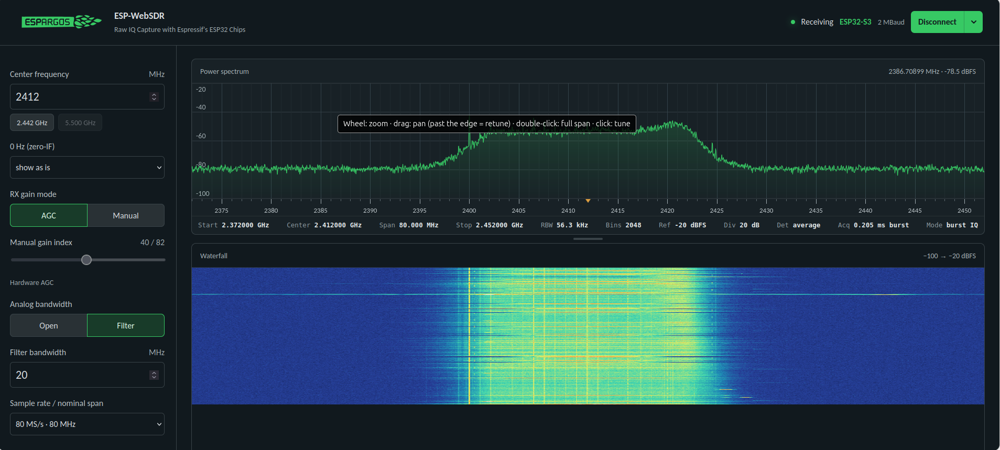

# ESP-SDR BLE

**Decoding Bluetooth Low Energy packets in software from an ESP32's raw radio samples.**

In October 2026, the [ESPARGOS](https://espargos.net/espsdr/) team published
[ESP-SDR](https://github.com/ESPARGOS/esp-sdr), firmware that uses an undocumented debug
path to read raw I/Q samples from the receiver of an ordinary ESP32. That turns a $10 dev
board into a receive-only software-defined radio for the 2.4 GHz band.

This project goes one step further: it takes those raw samples and demodulates Bluetooth
Low Energy advertising packets entirely in Python, without the chip's built-in Bluetooth
modem. Because it works from the raw signal, it can also measure things the built-in modem
hides: each device's crystal frequency error, the exact timing between packets, and the
signal-to-noise ratio of every packet.



## Results from real hardware

Captured with an ESP32-S3 dev board's onboard antenna, in a house, at 16 MS/s centered on
advertising channel 38 (2426 MHz):

```
#44 [ch38] SCAN_REQ         CRC OK     len=12  offset=+35 kHz match=0.88 t=42.4 us
#44 [ch38] SCAN_RSP         CRC OK     len=26  offset=+85 kHz match=0.89 t=369.5 us
    address: 4E:13:DE:97:CE:29 (random)
    Name: Echo Studio-31E
    TX power: 6 dBm
#187 [ch38] ADV_NONCONN_IND  CRC OK     len=14  offset=+54 kHz match=0.80 t=486.0 us
    address: E5:9D:78:BC:69:7A (random)
    Manufacturer data: Apple: 12020002 (Find My)
#389 [ch38] ADV_IND          CRC OK     len=15  offset=+53 kHz match=0.88 t=207.2 us
    address: FA:E6:6B:CD:42:C9 (random)
    Flags: 0x06
    Manufacturer data: Garmin: 1013
```

Devices seen included an Amazon Echo Studio, a Philips Hue bulb, a Google Nest device, an
Apple device sending Find My beacons, and a Garmin device. Every packet shown passed its
24-bit CRC.

**Timing check.** Snapshot #44 caught a complete exchange: a nearby device sent a scan request
to the Echo, and the Echo answered. The request is 12 bytes, so it lasts 80 + 12 × 8 = 176 µs
and ends at 218 µs. The response begins at 369.5 µs, 151 µs later. The Bluetooth spec
requires exactly 150 µs between the two, so packet timing is resolved to about 1 µs.

**Crystal fingerprints.** Each device's carrier offset stays constant from packet to packet
(the Echo read +85 to +87 kHz across eight packets), and differs from device to device. Over
an hour, every device's offset rose by about the same amount, which is the ESP32's own
crystal warming up, while the differences between devices held steady to within ~2 kHz.
The Echo also rotated its random address during that time; its offset relative to the
other devices stayed about the same, suggesting the new address belonged to the same device.

## Quick start

You need an ESP32 board supported by ESP-SDR (tested on an ESP32-S3) and Python 3.

1. Flash ESP-SDR from the [browser installer](https://espargos.net/espsdr/app/flash.html).
2. Install the Python packages:
   ```
   pip install -r requirements.txt
   ```
3. Close any browser tab using the board, then run:
   ```
   python3 esp_capture.py --save-hits hits
   ```
   Put a phone next to the board with Bluetooth on. Decoded packets print as they arrive,
   and snapshots containing packets are saved to `hits/`. Press Ctrl+C to stop.

On Linux, if the port won't open, add yourself to the `dialout` group
(`sudo usermod -aG dialout $USER`, then log out and back in). If the board keeps
resetting, stop ModemManager: `sudo systemctl stop ModemManager`.

## Tools

| File | Purpose |
|---|---|
| `esp_capture.py` | Pulls I/Q snapshots from the board over USB, decodes live, keeps a per-device table, and saves captures. |
| `ble_decode.py` | The decoder. Command-line tool for saved captures, and an importable module. |
| `make_test_signal.py` | Generates synthetic BLE packets as I/Q, for testing without hardware. |
| `test_decoder.py` | Self-tests (needs `pip install scapy`). |
| `fake_board.py` | Emulates an ESP-SDR board on a virtual serial port, for testing `esp_capture.py`. |

### Live capture

```
python3 esp_capture.py                          # decode live, Ctrl+C to stop
python3 esp_capture.py --quiet                  # device table only
python3 esp_capture.py --save caps --count 200  # save every snapshot, decode later
python3 esp_capture.py --gain 40                # manual gain instead of hardware AGC
python3 esp_capture.py --fc 2402                # advertising channel 37 (or 2480 for 39)
```

Defaults: 2426 MHz, 16 MS/s, and the board's largest snapshot (16,380 samples, 1.02 ms on
the S3). Snapshots are saved as `.ci8`: interleaved signed 8-bit I then Q.

### Device table

`--quiet` replaces per-packet output with a table that refreshes every 200 snapshots and
prints again on exit:

```
address            pkts  offset kHz  spread     ppm  SNR dB  device
FA:E6:6B:CD:42:C9     2       +61.4     0.1    -0.8      11  Garmin
5E:73:64:58:59:56     1       +92.1     0.0   +11.8      22  Amazon
E6:D3:DD:DA:DC:6E     1       +65.5     0.0    +0.8      12  Signify (Philips Hue)
```

- **offset kHz**: carrier offset, fitted over the whole packet. This is the device's
  crystal error plus the ESP32's own.
- **spread**: standard deviation of the offset across that device's packets.
- **ppm**: the device's crystal error after subtracting the median offset of all devices,
  which mostly cancels the ESP32's error. Needs at least three devices.
- **SNR dB**: packet power compared with the empty parts of the same snapshot, so it
  stays meaningful with automatic gain control on.

### Decoding saved files

```
python3 ble_decode.py hits/*.ci8 --fs 16 --fc 2426
python3 ble_decode.py hits/*.ci8 --fs 16 --fc 2426 --summary
python3 ble_decode.py recording.cf32 --fs 80 --fc 2441 --all
```

- `--fs` sample rate in MS/s, `--fc` center frequency in MHz.
- Formats: `ci8`/`cs8`, `cu8` (RTL-SDR style), `ci16`, `cf32`/`cfile`, `.npy`, stereo
  `.wav`, chosen by file extension or `--format`.
- `--all` also shows packets that failed CRC or ran past the end of the snapshot.
- `--flip auto|no|yes` handles swapped I and Q. Auto tries both.

The decoder works with I/Q from any SDR, not only the ESP32. With a span of 80 MHz centered
on 2441 MHz, it decodes all three advertising channels at once.

## How it works

1. **Channelize.** Each advertising channel inside the capture (37 = 2402 MHz,
   38 = 2426 MHz, 39 = 2480 MHz) is shifted to 0 Hz, low-pass filtered, and decimated to
   8 samples per bit.
2. **FM demodulate.** The phase change between consecutive samples gives the instantaneous
   frequency. BLE sends a 1 as about +250 kHz and a 0 as about −250 kHz.
3. **Find packets.** Every advertising packet starts with the same 40 bits: preamble `0xAA`
   and access address `0x8E89BED6`. Sliding that pattern along the frequency track and
   measuring the normalized correlation locates packets and their bit timing. A strongly
   negative match means I and Q are swapped.
4. **Estimate carrier offset.** A least-squares fit of the frequency track against the
   expected Gaussian-filtered pattern of the known bits gives the offset and frequency
   deviation. After the CRC passes, every bit is known, so the fit is repeated over the
   whole packet for a more precise offset.
5. **Slice bits.** Each bit is averaged over the middle half of its period and compared with
   the offset.
6. **Dewhiten.** BLE scrambles everything after the access address with a 7-bit LFSR
   (x⁷ + x⁴ + 1) seeded by the channel number. XOR with the same sequence undoes it.
7. **Check the CRC.** 24-bit CRC, polynomial `0x00065B`, initial value `0x555555` for
   advertising.
8. **Parse.** PDU type, addresses, and advertising data fields: names, flags, TX power,
   service UUIDs and service data (Bluetooth SIG member UUIDs labeled), and manufacturer
   data (company IDs and Apple message types labeled).

### Why 16 MS/s

ESP-SDR captures snapshots of up to 16,380 samples, with gaps in between. At 80 MS/s a
snapshot lasts 205 µs, but an advertising packet lasts 80 µs plus 8 µs per byte:

| Packet | Duration | Fits in 205 µs? | Fits in 1.02 ms? |
|---|---|---|---|
| Address + flags + 3-character name (14 B) | 192 µs | Only if it starts in the first 13 µs | Yes |
| Typical phone advertisement (20–31 B) | 240–330 µs | No | Yes |
| Largest legacy advertisement (37 B) | 376 µs | No | Yes |

At 16 MS/s the same snapshot lasts 1.02 ms and holds any advertising packet, at the cost of
covering one advertising channel at a time.

## Validation

`test_decoder.py` checks the decoder against independent references and synthetic signals:

- **Whitening** matches a separately written byte-oriented LFSR (the formulation used in
  Ubertooth) on five channels.
- **CRC** matches [scapy](https://scapy.net/)'s BTLE implementation.
- **Decoding** works on all three advertising channels at 80 MS/s, with swapped I/Q, from an
  8-bit file at 20 MS/s with a −120 kHz offset, and on a scan request and response in one
  snapshot. Truncated packets are flagged, and pure noise produces no false packets.
- **Offset accuracy**: within 0.4 kHz (0.15 ppm) of the true value at 15 dB SNR.

Decode rate against signal-to-noise ratio in a 2 MHz channel, 50 synthetic packets each:

| SNR | 6 dB | 8 dB | 10 dB | 12 dB | 15 dB |
|---|---|---|---|---|---|
| Decoded | 0 | 0 | 9 | 34 | 50 |

A dedicated BLE receiver works down to roughly 8–10 dB. This decoder is 2–3 dB behind,
mostly because it makes a hard decision on each bit.

## Limitations

- **Low duty cycle.** Snapshots arrive about four times per second over USB, so the board
  listens about 0.4% of the time and catches a fraction of the packets in the air.
- **One channel at a time** at 16 MS/s.
- **Uncalibrated levels.** ESP-SDR gain isn't calibrated in dB, so signal strength is
  reported only as SNR.
- **Advertising only.** Connection traffic hops across 37 data channels on a schedule set
  at connection time; following it needs continuous capture.
- **LE 1M PHY only.** LE 2M and Coded PHY aren't supported yet.

## Next steps

- Soft-decision or matched-filter demodulation to recover the 2–3 dB gap.
- Device tracking across address rotation, using carrier offset as a fingerprint.
- LE 2M PHY support.
- Direction finding with several phase-coherent ESP32s, as on the ESPARGOS array.

## Credits

- [ESPARGOS](https://espargos.net/) (Florian Euchner and contributors) for ESP-SDR, the
  firmware that makes raw I/Q capture possible, and ESP-WebSDR. This project uses their
  documented serial protocol and contains none of their code.
- The Bluetooth Core Specification for the packet format, whitening, and CRC definitions.
- Developed by David Bjorndalen with assistance from Claude (Anthropic).

## License

GPL-3.0-or-later, matching ESP-SDR. See [LICENSE](LICENSE).
